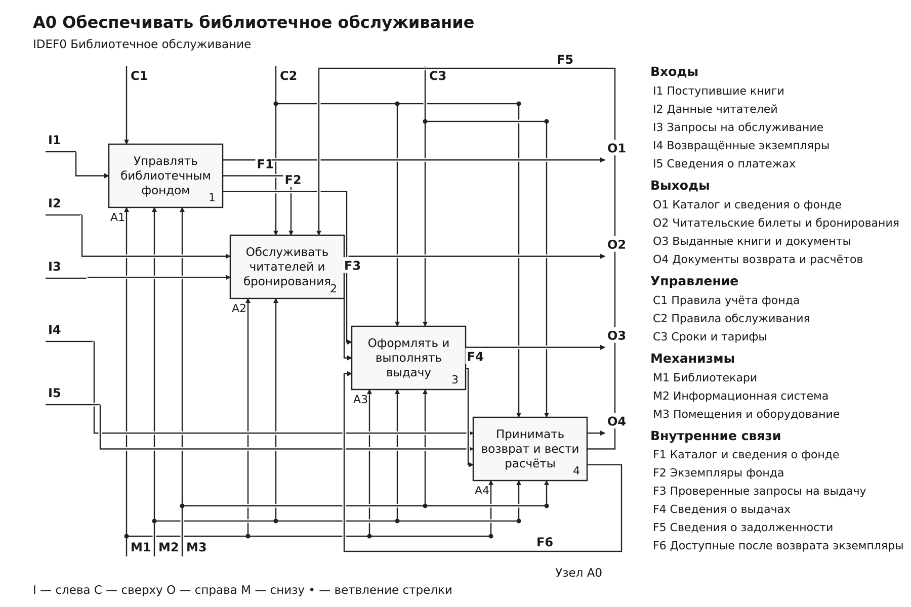
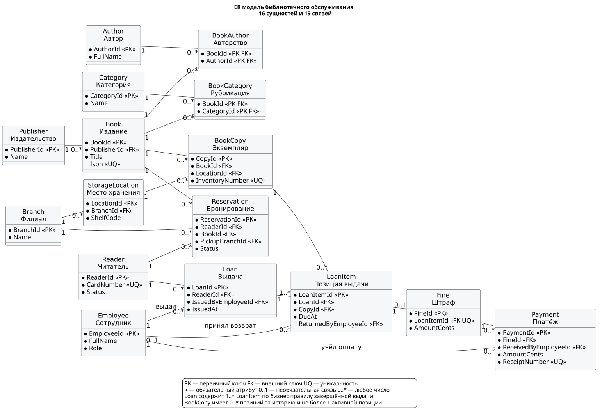

# Лабораторная работа №3

**Построение IDEF0 и UML/ER-диаграмм**  
Дисциплина: «Коллективная разработка приложений».  
Выполнил: Тишин М. С., группа ВБИо-401рсоб.

Предметная область — библиотечное обслуживание. Работа развивает каталог из лабораторной №2: учёт экземпляров в филиалах, регистрация читателей, бронирование, выдача, возврат и расчёты.

## Материалы для сдачи

| Материал | Файл |
| --- | --- |
| Полный отчёт с заполненным титульным листом | [ЛР03.docx](reports/ЛР03.docx) |
| IDEF0: шесть редактируемых страниц | [library_idef0.drawio](diagrams/idef0/library_idef0.drawio) |
| ER-модель: 16 сущностей, 19 связей | [library_er.puml](diagrams/er/library_er.puml) |
| Схема SQLite и учебные данные | [library.sql](schema/library.sql), [demo.sql](schema/demo.sql) |
| Результаты 42 проверок | [checks.txt](evidence/checks.txt) |
| Три выполненных сценария | [scenarios.json](evidence/scenarios.json) |
| Соответствие заданию | [requirements.md](docs/requirements.md) |

Отчёт содержит цель, описание предметной области, функции системы, все диаграммы, структуру данных, атрибуты и кардинальности, три сценария и вывод. Данные титульного листа перенесены из предыдущей работы; заменены номер и тема.

## Диаграммы

| Узел | Содержание | Просмотр |
| --- | --- | --- |
| A-0 | Контекст | [SVG](diagrams/idef0/A-0.svg), [PNG](diagrams/idef0/A-0.png) |
| A0 | Четыре основные функции | [SVG](diagrams/idef0/A0.svg), [PNG](diagrams/idef0/A0.png) |
| A1 | Учёт фонда: A11–A13 | [SVG](diagrams/idef0/A1.svg), [PNG](diagrams/idef0/A1.png) |
| A2 | Обслуживание читателей: A21–A23 | [SVG](diagrams/idef0/A2.svg), [PNG](diagrams/idef0/A2.png) |
| A3 | Выдача книг: A31–A33 | [SVG](diagrams/idef0/A3.svg), [PNG](diagrams/idef0/A3.png) |
| A4 | Возврат и расчёты: A41–A43 | [SVG](diagrams/idef0/A4.svg), [PNG](diagrams/idef0/A4.png) |
| ER | Сущности, ключи и связи | [SVG](diagrams/er/library_er.svg), [PNG](diagrams/er/library_er.png) |





Входы I подходят слева, выходы O уходят справа, управление C приходит сверху, механизмы M — снизу. Коды стрелок локальны для страницы; полные названия находятся в легенде справа. Точка показывает ветвление или объединение, пересечение без точки не создаёт связь. Граничные стрелки согласованы по смыслу между родителем и декомпозицией.

## Запуск проверок

Нужен Python 3.12 или новее. Внешние пакеты для проверок не требуются: SQLite и unittest входят в Python. Из корня проекта:

```bash
python scripts/verify.py
```

Команда выполняет 42 проверки и три сценария на временной базе SQLite. Файлы `checks.txt`, `scenarios.json` и `environment.json` появятся в каталоге `artifacts/`. В `evidence/` сохранён фактический результат локального запуска; каждый push и pull request запускает проверки через GitHub Actions.

Для отдельного запуска сценариев:

```bash
python scripts/demo_scenarios.py --output artifacts/scenarios.json
```

1. Новый читатель получает билет CARD-003 и бронирует издание.
2. Создаётся выдача и её позиция; бронирование завершается, экземпляр исключается из доступных.
3. Возврат с условной просрочкой три дня создаёт штраф 3000 копеек. Платежи 1000 и 2000 копеек погашают долг; экземпляр доступен снова.

Тариф 10 рублей за календарный день и даты октября 2026 года заданы для учебного примера. Это модель правил выбранной библиотеки.

## Как редактировать и пересобрать

Откройте `.drawio` в Diagrams.net: **File → Open from → Device**. В документе шесть страниц с отдельными блоками и стрелками. ER-модель можно редактировать в любом редакторе PlantUML.

Канонические описания находятся в [idef0.json](model/idef0.json) и [entities.json](model/entities.json). Для согласованного обновления IDEF0 и исходника ER:

```bash
python scripts/build_diagrams.py
```

Эта команда обновляет SVG и `.drawio` для IDEF0, а также `.puml` для ER. ER-SVG можно пересоздать официальным PlantUML 1.2026.8 и Java:

```bash
java -jar plantuml-1.2026.8.jar -tsvg -charset UTF-8 diagrams/er/library_er.puml
```

Используется встроенная раскладка Smetana. PNG и отчёт обновляются после изменения диаграмм отдельно. Для сдачи уже включены готовые экспорты и DOCX.

## Правила модели данных

`Book` описывает издание, `BookCopy` — физический экземпляр. Связи с авторами и категориями реализованы через `BookAuthor` и `BookCategory`. `Loan` содержит позиции `LoanItem`; даты возврата и принявший сотрудник отсутствуют до возврата и заполняются одновременно.

История экземпляра содержит много выдач, но частичный уникальный индекс допускает только одну активную позицию. Проверяются статус читателя, пригодность экземпляра, отсутствие долга, лимит пяти активных книг, сроки и суммы платежей. Деньги хранятся целым числом копеек. Для внешних ключей каждое подключение включает `PRAGMA foreign_keys = ON`.

Кратность `Loan 1 — 1..* LoanItem` описывает завершённую операцию: документ и позиции создаются одной транзакцией. Один внешний ключ сам по себе не требует наличия дочерней записи. Подробности всех 19 связей приведены в отчёте и [описании модели](docs/model.md).

## Источники

- [Задание и соответствие требованиям](docs/requirements.md).
- [NIST FIPS PUB 183 — IDEF0](https://nvlpubs.nist.gov/nistpubs/Legacy/FIPS/fipspub183.pdf).
- [Diagrams.net: формат редактируемых диаграмм](https://www.drawio.com/docs/reference/diagram-generation/).
- [PlantUML: ER / Information Engineering](https://plantuml.com/ie-diagram).
- [SQLite: внешние ключи](https://www.sqlite.org/foreignkeys.html).
